<a href="https://hammedrz.github.io">
  <picture>
    <source media="(prefers-color-scheme: dark)" srcset="assets/neofetch-dark.svg">
    
  </picture>
</a>

  
  
  
  

### `$ cat about.txt`

I'm Hamed, a medical student in Tehran who writes code. I work where medicine meets software: medical AI, LLM tooling, and a lot of small Linux tools I build for myself first and share when they turn out useful. Most of it is Python, and nearly all of it ends up in a container: if it runs on one of my servers, it runs with `docker compose up -d`.

### `$ ./medalak --about`

**[Medalak (مداَلَک)](https://medalak.ir)** is my small startup: AI fact-checking for health claims, in Persian. Forward a suspicious message (text, image, video or a voice note) to the website or the [Telegram bot](https://t.me/medalak_bot). Medalak pulls out the medical claim, searches PubMed, weighs the evidence and replies with a verdict and the sources, usually in under a minute.

### `$ ls ~/projects`

| Project | What it does | Built with |
| --- | --- | --- |
| [**v-touchpad**](https://github.com/hammedrz/v-touchpad) | On-screen touchpad for Linux touchscreens and 2-in-1s, with real gestures through a virtual uinput device | Python · PySide6 · GNOME |
| [**inferssd-studio**](https://github.com/hammedrz/inferssd-studio) | GNOME app to chat with and serve MoE models whose experts stream from your SSD, with an OpenAI-compatible API | Python · GTK4 · libadwaita |
| [**url2tg**](https://github.com/hammedrz/url2tg) | Download from any URL straight to Telegram, Bot API for small files and MTProto for files up to 2 GB | Python · Telethon |
| [**quicklaunch-ai**](https://github.com/hammedrz/quicklaunch-ai) | Spotlight-style AI launcher for Windows: Gemini, OpenAI-compatible and local models, agent mode | Python · PySide6 |
| [**ournotes-server**](https://github.com/hammedrz/ournotes-server) | Self-hosted sync server for the ournotes Android app, with Quick-Pair QR codes | Docker · SQLite · Node |

### `$ echo $STACK`

  
  
  
  
  
  
  
  
  
   
  
  
  
  
  
  
  

### `$ git log --graph`

<picture>
  <source media="(prefers-color-scheme: dark)" srcset="https://raw.githubusercontent.com/hammedrz/hammedrz/output/github-snake-dark.svg">
  
</picture>

`hamed@github:~$ exit` · come say hi on my <a href="https://hammedrz.github.io">desktop</a>.
